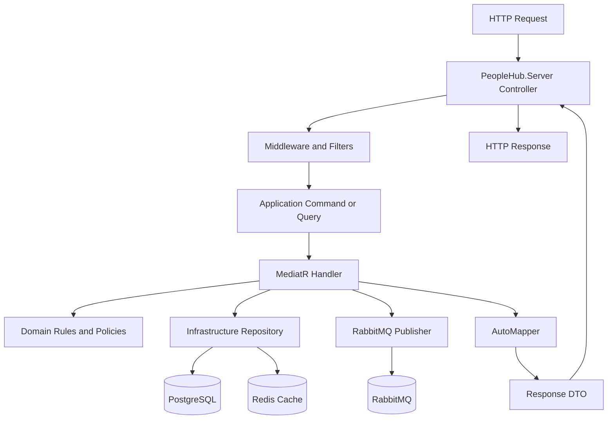
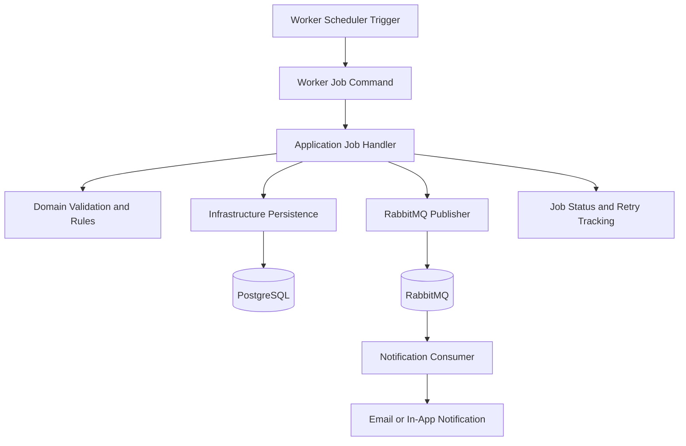
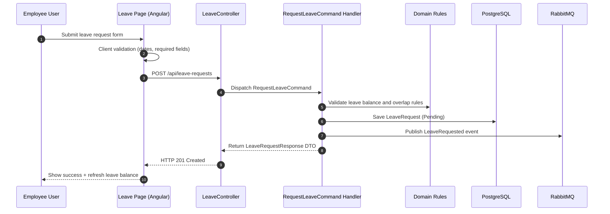
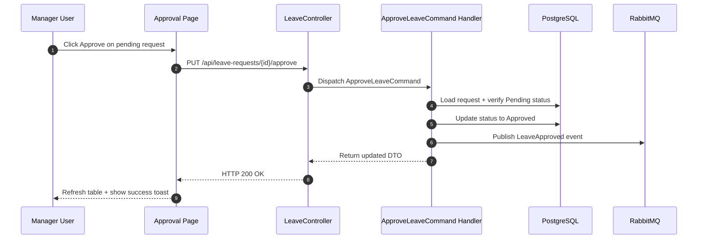
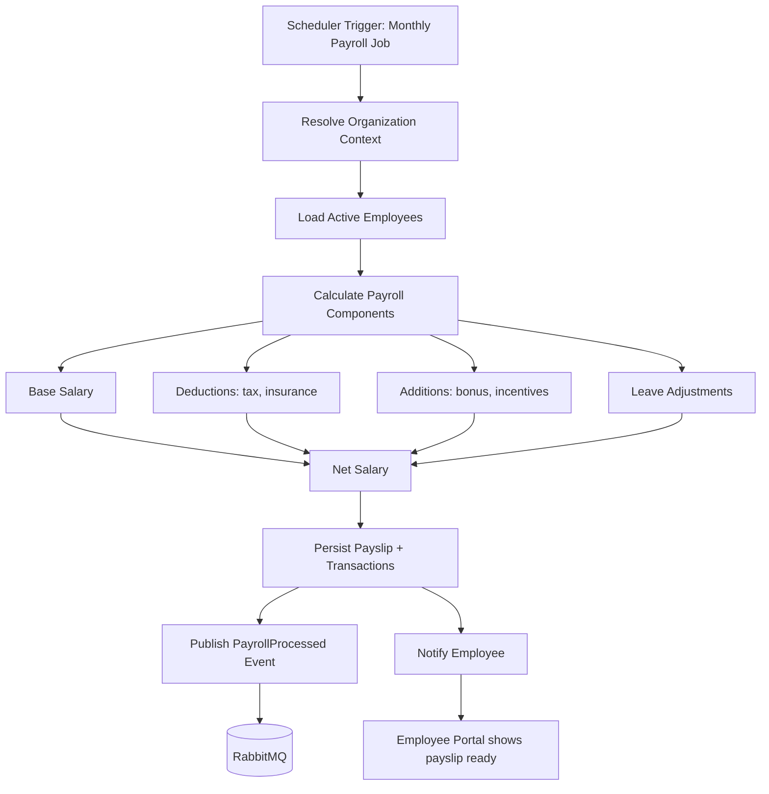
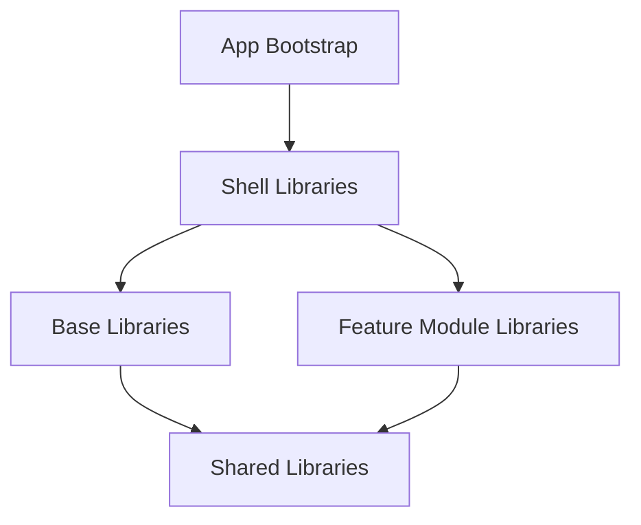

# PeopleHub Architecture - Single Source of Truth

## Project Overview and Vision

PeopleHub is a multi-organization HRMS platform designed for SaaS-style scale, organization-level customization, and modular growth across backend and frontend workstreams.

Primary business capabilities:
- Employee lifecycle and organization management.
- Attendance, leave, payroll, recruitment, performance, and reporting.
- Organization-aware branding, navigation, and feature controls.
- Integration-driven workflows (notifications, messaging, storage, and external APIs).

Architecture goals:
- Keep business logic isolated and testable through clean layering.
- Maintain strict dependency direction and public API boundaries.
- Support asynchronous and scheduled workloads through worker and messaging patterns.
- Preserve extensibility with configuration/strategy-driven organization customization.

### Core Principles
- Clean Architecture with explicit boundaries.
- Domain-first modeling and CQRS orchestration.
- Organization-first multi-tenancy.
- API-first delivery for web, worker, and integration channels.
- Library-driven frontend modularity with reusable shared assets.

## 1. Project Versions

### Runtime and Framework Versions (current from repository)

#### Backend
- Target framework: .NET 10 (`net10.0`)
- C# language standard: C# 13 (architecture standard)
- ASP.NET Core OpenAPI package: `Microsoft.AspNetCore.OpenApi` 10.0.2
- Worker host package: `Microsoft.Extensions.Hosting` `10.*`
- ASP.NET SPA proxy: `Microsoft.AspNetCore.SpaProxy` `10.*-*`
- EF Core: 8+ (architecture standard)
- MediatR: required for CQRS orchestration (architecture standard)
- AutoMapper: required for DTO/domain mapping (architecture standard)
- Redis cache: required for distributed caching (architecture standard)
- RabbitMQ: required for async messaging/event workflows (architecture standard)
- xUnit: required backend unit/integration test framework (architecture standard)
- Moq: required mocking framework for backend tests (architecture standard)
- Database target: PostgreSQL 13+ (architecture target)
- Logging stack status: Serilog is not currently referenced in repository package/project manifests

#### Frontend
- Framework: Angular 21 (`@angular/*` `^21.0.0`)
- Angular CLI: `^21.0.0`
- ng-packagr: `^21.0.0`
- TypeScript: `~5.9.0`
- RxJS: `~7.8.0`
- Zone.js: `~0.15.0`
- Storybook: 10.3.4 (`storybook`, `@storybook/angular`)
- Tailwind CSS: `^4.2.2`
- Jasmine: `~5.2.0`
- Karma: `~6.4.0`
- Chart.js: `^4.5.1`
- Iconify runtime: `iconify-icon` `^3.0.2`
- Iconify icon packs: `@iconify/icons-*` family (for example `@iconify/icons-lucide` `^1.2.135`, `@iconify/icons-material-symbols` `^1.2.58`, `@iconify-icons/tabler` `^1.2.95`)

#### Tooling and Local Environment
- Node.js runtime: `v20.19.2` (local environment)
- npm version: `10.8.2` (local environment)
- IDE target: Visual Studio 2026 (team standard)

### Platform Notes
- Workspace currently follows Angular CLI multi-library layout with Nx-style boundaries.
- No explicit `nx.json` detected in this repository snapshot.
- PostgreSQL provider package/configuration is not yet pinned in current server project files.
- Backend architecture stack items (EF Core/MediatR/AutoMapper/Redis/RabbitMQ/xUnit/Moq) are documented as standards and should be package-pinned explicitly in project manifests.

## 2. Backend Architecture (Clean Architecture)

### Layering and Dependency Direction
- `PeopleHub.Server` -> `PeopleHub.Application` -> `PeopleHub.Domain`
- `PeopleHub.Infrastructure` depends on `PeopleHub.Application` and `PeopleHub.Domain`
- `PeopleHub.Worker` depends on `PeopleHub.Application` and `PeopleHub.Infrastructure`

### Layer Responsibilities
- Domain: entities, value objects, enums, domain rules/events; no infrastructure dependencies.
- Application: use-case orchestration, CQRS handlers, validation, DTO mapping, ports/interfaces.
- Infrastructure: persistence, integrations, caching, storage, identity, messaging implementations.
- Server: HTTP transport, controllers, middleware pipeline, auth surface, request/response policies.
- Worker: background jobs, schedulers, consumers, asynchronous workflows.

### CQRS Pattern
- Commands and queries are organized by module under Application.
- Validation and pipeline behaviors apply cross-cutting concerns.
- Controllers stay thin and delegate behavior to Application layer.

### Multi-tenancy (organization-first)
- Organization context is treated as a first-class business boundary.
- Organization scoping must be enforced in API, caching keys, and data access.
- Use "organization" terminology in code and docs unless external contract requires "tenant".

### Server Controller and Middleware Organization
- Controllers are grouped by business area: Attendance, Auth, Employees, Leave, Organization, Payroll, Recruitment, Reports, Settings, SuperAdmin.
- Middleware and Filters centralize cross-cutting concerns (logging, auth handling, error shaping, context propagation).

## 3. Frontend Architecture (Monorepo Libraries)

### Frontend Library Domains
- `src/libs/base`: core app foundations and app-level concerns.
- `src/libs/shell`: layout, header, sidebar, breadcrumbs, quick actions.
- `src/libs/shared`: reusable UI, forms, auth, api, common types, directives, pipes, theme tokens, utils.
- `src/libs/modules`: business-feature libraries (employees, attendance, leave, payroll, etc.).
- `src/libs/extensions`: customization and plugin style extension points.

### Frontend Workspace Blueprint

```text
peoplehub.client/
├─ src/app/                 app root bootstrap, providers, and route composition
├─ src/libs/
│  ├─ shared/               cross-feature reusable libraries
│  ├─ base/                 app infrastructure and context libraries
│  ├─ shell/                layout and navigation shell libraries
│  ├─ modules/              business feature libraries
│  └─ extensions/           organization-specific extension points
├─ src/assets/              static frontend assets (images, icons, fonts)
├─ src/styles/              global styles and tokens
├─ src/environments/        environment configuration
└─ angular.json, tsconfig*, package.json, proxy.conf.js, karma.conf.js
```

### Library Responsibilities
- Shared libraries (`src/libs/shared`) provide reusable building blocks:
  - `ui`: component system (primitives, controls, charts)
  - `forms`: validators, builders, and form helpers
  - `common`: shared models, DTOs, and constants
  - `api`: HTTP services and request pipeline helpers
  - `auth`: authentication/authorization guards and flows
  - `directives`, `pipes`, `theme-tokens`, `utils`
- Base libraries (`src/libs/base`) provide application infrastructure:
  - `app-shell`, `navigation`, `branding`, `feature-flags`
  - `organization-context`, `organization-config`, `app-initialization`
- Shell libraries (`src/libs/shell`) provide presentation shell:
  - `layout`, `header`, `sidebar`, `breadcrumbs`, `quick-actions`
- Module libraries (`src/libs/modules`) implement business features:
  - `dashboard`, `employees`, `attendance`, `leave`, `payroll`, `recruitment`, `performance`, `reports`, `notifications`, `documents`, `settings`, `super-admin`

### Feature Module Internal Shape
- Standard module layout under `src/libs/modules/<module>/src/lib`:
  - `routes/` for lazy-route definitions
  - `pages/` for container/smart components
  - `components/` for presentation components
  - `services/`, `models/`, `config/`, `guards/`, `resolvers/`
  - `public-api.ts` for exported module surface

### Component Layering Model
- `shared/ui/components/primitives`: foundational UI blocks (button, icon, toast, table, tooltip).
- `shared/ui/components/controls`: form controls (dropdown, checkbox, text-box, calendar, file-upload).
- `shared/ui/components/charts`: data visualization (line, bar, scatter, doughnut, org-chart).
- Feature components in module libraries compose shared UI and feature services.

### Component Communication Patterns
- Smart container/page components live in feature libraries.
- Shared reusable components live in shared libraries and expose inputs/outputs only.
- Cross-library communication occurs through typed APIs/services and exported public contracts.

### Frontend Dependency Direction

```text
app (root)
  -> shell
  -> modules

shell -> base -> shared
modules -> base
modules -> shared
shared -> (no module dependencies)

Rule: Shared <- Base <- Shell <- App
Rule: Shared <- Base <- Modules
No circular dependencies.
```

### Frontend File and Selector Conventions
- Each component must include:
  - `<name>.component.ts`
  - `<name>.component.html`
  - `<name>.component.scss`
  - `<name>.component.spec.ts`
  - `<name>.stories.ts`
- Selector prefixes:
  - shared UI components: `ui-*`
  - other shared/base/shell/modules: `ph-*`
  - app root: `app-root`
- Interfaces/models are kept in dedicated `*.model.ts` or `*.types.ts` files, not in component files.

### Theming and Styling Standards
- Use SCSS with design tokens/CSS variables from theme token libraries.
- Avoid hard-coded color/spacing values in component styles when token equivalents exist.
- Maintain light/dark theme variable sets in shared theme token assets.

### Library Build Process
- Libraries use ng-packagr builder in `angular.json`.
- Every library exposes via `src/public-api.ts`.
- Build output lands under `peoplehub.client/dist/<library>`.

### Routing, Environment, and Build Conventions
- Feature routes are lazy-loaded from module library entry points.
- Environment-specific values live in `src/environments`.
- Common frontend build commands:
  - `ng serve` / `npm start`
  - `ng build <library>` for library builds
  - `ng build --configuration production`
  - `npm run storybook` and `npm run build-storybook`
- Path aliases (`@ph/shared/*`, `@ph/modules/*`, `@ph/base/*`, `@ph/shell/*`) are defined in TypeScript config and must be preferred over deep relative imports.

## 4. Folder-by-Folder Explanation

```text
PeopleHub/
├─ .github/
│  Purpose: CI/CD workflows and repository automation.
│  Do not put: runtime application code.
│
├─ core/
│  Purpose: backend clean-architecture layers.
│  ├─ PeopleHub.Domain/
│  │  Purpose: pure business entities, value objects, rules, events.
│  │  Do not put: EF, HTTP, external integration code.
│  ├─ PeopleHub.Application/
│  │  Purpose: use cases, CQRS handlers, validators, interfaces.
│  │  Do not put: controller logic and DB-provider specifics.
│  ├─ PeopleHub.Infrastructure/
│  │  Purpose: persistence, integrations, caching, messaging implementations.
│  │  Do not put: UI logic or domain shortcuts.
│  └─ PeopleHub.Worker/
│     Purpose: background jobs, schedulers, consumers.
│     Do not put: HTTP controllers.
│
├─ PeopleHub.Server/
│  Purpose: API transport layer and host composition.
│  ├─ Common/         Purpose: server-local shared constants/helpers.
│  ├─ Configuration/  Purpose: app settings and options binding.
│  ├─ Contracts/      Purpose: HTTP request/response contracts.
│  ├─ Controllers/    Purpose: feature endpoints; keep thin.
│  ├─ Extensions/     Purpose: DI/host registration extensions.
│  ├─ Filters/        Purpose: reusable MVC policies.
│  └─ Middleware/     Purpose: request pipeline concerns.
│
├─ peoplehub.client/
│  Purpose: Angular frontend workspace.
│  ├─ src/app/
│  │  Purpose: app bootstrap and root routing composition.
│  │  Files: app.component.ts/html/scss/spec, app.stories.ts,
│  │         iconify-icon.component.ts, iconify-icon.stories.ts,
│  │         weather-forecast.service.ts
│  │  Folders: bootstrap/, providers/, routes/
│  │  Do not put: generic shared library code.
│  ├─ src/libs/
│  │  Purpose: modular frontend architecture.
│  │  ├─ base/
│  │  │  Purpose: foundational app services and context.
│  │  │  ├─ app-shell/
│  │  │  ├─ branding/
│  │  │  ├─ feature-flags/
│  │  │  ├─ navigation/
│  │  │  ├─ organization-config/
│  │  │  └─ organization-context/
│  │  │  Each base library leaf files:
│  │  │    ng-package.json, package.json,
│  │  │    tsconfig.lib.json, tsconfig.lib.prod.json, tsconfig.spec.json,
│  │  │    src/public-api.ts,
│  │  │    src/lib/<name>.component.ts, src/lib/<name>.component.spec.ts,
│  │  │    src/lib/<name>.stories.ts,
│  │  │    src/lib/services/<name>.service.ts, src/lib/services/<name>.service.spec.ts
│  │  ├─ shell/
│  │  │  Purpose: layout frame and navigation shell.
│  │  │  ├─ breadcrumbs/
│  │  │  ├─ header/
│  │  │  ├─ layout/
│  │  │  ├─ quick-actions/
│  │  │  └─ sidebar/
│  │  │  Each shell library leaf files:
│  │  │    ng-package.json, package.json,
│  │  │    tsconfig.lib.json, tsconfig.lib.prod.json, tsconfig.spec.json,
│  │  │    src/public-api.ts,
│  │  │    src/lib/<name>.component.ts, src/lib/<name>.component.spec.ts,
│  │  │    src/lib/<name>.stories.ts,
│  │  │    src/lib/services/<name>.service.ts, src/lib/services/<name>.service.spec.ts
│  │  ├─ shared/
│  │  │  Purpose: reusable cross-feature assets.
│  │  │  ├─ api/
│  │  │  │  Leaf files: src/lib/api.component.ts/spec/stories,
│  │  │  │             src/lib/services/api.service.ts/spec,
│  │  │  │             src/lib/services/requester.service.ts/spec,
│  │  │  │             plus ng-package/package/tsconfig/public-api files.
│  │  │  ├─ auth/
│  │  │  │  Leaf files: src/lib/auth.component.ts/spec/stories,
│  │  │  │             src/lib/services/auth.service.ts/spec,
│  │  │  │             src/lib/config/form-configs/*.ts,
│  │  │  │             plus ng-package/package/tsconfig/public-api files.
│  │  │  ├─ common/
│  │  │  │  Leaf files: src/lib/common.component.ts/spec/stories,
│  │  │  │             src/lib/constants/api-names.ts,
│  │  │  │             src/lib/models/**/*.ts,
│  │  │  │             src/lib/services/common.service.ts/spec,
│  │  │  │             src/lib/services/dropdown.service.ts,
│  │  │  │             src/lib/services/requester.service.ts,
│  │  │  │             plus ng-package/package/tsconfig/public-api files.
│  │  │  ├─ directives/
│  │  │  │  Leaf files: src/lib/directives.component.ts/spec/stories,
│  │  │  │             src/lib/services/directives.service.ts/spec,
│  │  │  │             plus ng-package/package/tsconfig/public-api files.
│  │  │  ├─ forms/
│  │  │  │  Leaf files: src/lib/forms.component.ts/spec/stories,
│  │  │  │             src/lib/services/forms.service.ts/spec,
│  │  │  │             plus ng-package/package/tsconfig/public-api files.
│  │  │  ├─ pipes/
│  │  │  │  Leaf files: src/lib/duration.pipe.ts/spec,
│  │  │  │             src/lib/initials.pipe.ts/spec,
│  │  │  │             src/lib/pipes.component.ts/spec/stories,
│  │  │  │             src/lib/services/pipes.service.ts/spec,
│  │  │  │             plus ng-package/package/tsconfig/public-api files.
│  │  │  ├─ theme-tokens/
│  │  │  │  Leaf files: src/lib/theme-tokens.component.ts/spec/stories,
│  │  │  │             src/lib/services/theme-tokens.service.ts/spec,
│  │  │  │             plus ng-package/package/tsconfig/public-api files.
│  │  │  ├─ ui/
│  │  │  │  Purpose: reusable UI system (full component tree).
│  │  │  │  Leaf roots:
│  │  │  │    src/public-api.ts
│  │  │  │    src/lib/ui.component.ts/spec/stories
│  │  │  │    src/lib/migration-map-common-ui.csv
│  │  │  │    src/lib/assets/icons/icon-registry.ts
│  │  │  │    src/lib/models/**/*.ts
│  │  │  │    src/lib/services/**/*.ts
│  │  │  │  Component branches under src/lib/components:
│  │  │  │    charts/ -> dial-chart, doughnut-chart, employee-org-chart,
│  │  │  │              horizontal-bar-chart, line-chart, org-chart,
│  │  │  │              progress-chart, scatter-chart, spinning-chart
│  │  │  │    controls/ -> button, calendar, calendar-timer, checkbox, chip,
│  │  │  │                detailed-calendar, dropdown, file-upload, icon-button,
│  │  │  │                icon-button-popup, label-value, multi-select,
│  │  │  │                number-box, otp, password, progress-bar, search-bar,
│  │  │  │                search-dropdown, text-area, text-box, timepicker,
│  │  │  │                toggle, value-dropdown
│  │  │  │    primitives/ -> a4-doc, accordian, bullet-list, buttonlist,
│  │  │  │                 caller, confirm-popup, count-widget, dot, icon,
│  │  │  │                 loader, menu-bar, notice-banner, pagination,
│  │  │  │                 table, toast, toast-stack, tooltip
│  │  │  │  For each component branch, leaf files are maintained as:
│  │  │  │    <name>.component.ts
│  │  │  │    <name>.component.html
│  │  │  │    <name>.component.scss
│  │  │  │    <name>.component.spec.ts
│  │  │  │    <name>.stories.ts
│  │  │  │  Plus library build/config files:
│  │  │  │    ng-package.json, package.json,
│  │  │  │    tsconfig.json, tsconfig.lib.json,
│  │  │  │    tsconfig.lib.prod.json, tsconfig.spec.json
│  │  │  └─ utils/
│  │  │     Leaf files: src/lib/utils.component.ts/spec/stories,
│  │  │                src/lib/services/utils.service.ts/spec,
│  │  │                plus ng-package/package/tsconfig/public-api files.
│  │  ├─ modules/
│  │  │  Purpose: feature-specific business libraries.
│  │  │  ├─ attendance/
│  │  │  ├─ dashboard/
│  │  │  ├─ documents/
│  │  │  ├─ employees/
│  │  │  ├─ leave/
│  │  │  ├─ notifications/
│  │  │  ├─ payroll/
│  │  │  ├─ performance/
│  │  │  ├─ recruitment/
│  │  │  ├─ reports/
│  │  │  ├─ settings/
│  │  │  └─ super-admin/
│  │  │  Each module branch leaf files:
│  │  │    ng-package.json, package.json,
│  │  │    tsconfig.lib.json, tsconfig.lib.prod.json, tsconfig.spec.json,
│  │  │    src/public-api.ts,
│  │  │    src/lib/<module>.component.ts, src/lib/<module>.component.spec.ts,
│  │  │    src/lib/<module>.stories.ts,
│  │  │    src/lib/services/*.ts, src/lib/services/*.spec.ts
│  │  │  Module-specific config branches:
│  │  │    documents/src/lib/config/**
│  │  │    employees/src/lib/config/**
│  │  │    leave/src/lib/config/**
│  │  │    notifications/src/lib/config/**
│  │  └─ extensions/
│  │     Purpose: plugin and customization extension points.
│  │     └─ org-a/
│  │        Leaf files:
│  │          ng-package.json, package.json,
│  │          tsconfig.lib.json, tsconfig.lib.prod.json, tsconfig.spec.json,
│  │          src/public-api.ts,
│  │          src/lib/org-a.component.ts/spec/stories,
│  │          src/lib/services/org-a.service.ts/spec
│  ├─ src/assets/
│  │  Purpose: static assets (images/icons/fonts).
│  ├─ src/styles/
│  │  Purpose: global styles and tokens.
│  │  Leaf files: common-css.scss
│  └─ src/environments/
│     Purpose: environment-specific runtime configuration.
│
├─ docs/
│  Purpose: architecture, standards, and runbooks.
│  Do not put: implementation code.
│
├─ scripts/
│  Purpose: repeatable automation and migration tooling.
│  Do not put: production runtime business logic.
│
├─ tests/
│  Purpose: cross-project integration/e2e/performance tests.
│
└─ bin/ and obj/
  Purpose: generated build artifacts only.
  Do not put: hand-written source files.
```

### Structure Rules (quick reference)
- Shared libraries stay feature-agnostic.
- Feature business workflows stay inside `peoplehub.client/src/libs/modules/*`.
- API transport concerns stay in `PeopleHub.Server`; business rules stay in Domain/Application.
- Infrastructure implements interfaces; it does not redefine business policy.

## 5. File Patterns and Naming

### Required Library Surface
- Every library must expose a `src/public-api.ts`.
- Export only stable and intentional symbols from `public-api.ts`.
- Do not deep-import internals across library boundaries.

### Barrel Rules
- Library root barrel: only public surface.
- Feature/local barrels allowed for local convenience but must not create cyclic imports.
- Avoid wildcard export chains that hide ownership.

### Naming Conventions
- Components: kebab-case file names; PascalCase classes.
- Services: `*.service.ts` with single responsibility.
- Models/types/interfaces: grouped by feature in `*.model.ts` or `*.types.ts`.
- Never declare interfaces inside component files.
- Keep all related interfaces in one model/types file when practical.
- Component file set is mandatory:
  - `component.ts`
  - `component.html`
  - `component.scss`
  - `component.spec.ts`
  - `component.stories.ts`

### Selector Conventions
- Shared UI selectors: `ui-*`.
- Other library selectors generally use `ph-*` by library/domain convention.
- App root selector remains `app-root`.

## 6. Architectural Constraints

### Dependency Direction Rules
- Backend: Server -> Application -> Domain; Infrastructure -> Application/Domain.
- Frontend: shared libraries cannot import feature libraries.
- Base/shell may depend on shared, but shared must stay feature-agnostic.

### Shared vs Feature Boundaries
- Put code in shared only if truly reusable across features.
- Feature-specific workflows, policies, and state remain in feature module libraries.
- Avoid leaking business-specific logic into shared UI primitives.

### Library Import Restrictions
- Import through library public APIs whenever possible.
- No cross-feature deep relative imports.
- No circular library references.

### Multi-organization Isolation Rules
- Organization context must be resolved at request/job entry points.
- All data access paths must apply organization-scoped filtering.
- Cache keys and async message payloads must include organization identity.
- Organization customization must be injected by strategy/resolver patterns, not hard-coded feature branches.

### Authentication and Authorization Rules
- JWT-based authentication for API and UI session flow.
- Role and permission checks enforced in both route policies and API endpoints.
- Token refresh and 401/403 handling must be centralized in frontend HTTP pipeline.
- Super-admin operations must remain separated from organization-admin scopes.

## 7. Data Flow Diagrams

### 7.1 Backend Data Flow (API Request Lifecycle)

Backend request lifecycle steps:
1. HTTP request reaches `PeopleHub.Server` controller.
2. Middleware and filters apply context, auth, validation, and error policies.
3. Controller dispatches Application command/query (MediatR).
4. Handler executes Domain rules and coordinates Infrastructure.
5. Infrastructure reads/writes PostgreSQL and optional Redis cache.
6. Domain/application events are published through RabbitMQ when required.
7. AutoMapper maps domain/application models to response DTOs.
8. Controller returns standardized HTTP response payload.



### 7.1.1 Backend Worker Job Flow (Scheduler -> Handler -> DB -> RabbitMQ -> Notification)

Worker job lifecycle steps:
1. `PeopleHub.Worker` scheduler triggers a job (for example payroll, report, or reminder).
2. Worker resolves organization context and builds job command payload.
3. Job handler executes Application use case and Domain validations.
4. Infrastructure persists job results/state to PostgreSQL.
5. Relevant events are published to RabbitMQ for downstream processing.
6. Notification consumer/service sends user-facing notifications (email/in-app/SMS).
7. Worker records completion/failure status and retry metadata.



### 7.2 Use Case Flow: Employee Requests Leave



### 7.3 Use Case Flow: Manager Approves Leave



### 7.4 Use Case Flow: Monthly Payroll Processing



### 7.5 Frontend Library Interaction Flow



## 8. Common-UI Migration Governance

### Source Read-only Rule
- Source reference path for migration inputs is read-only.
- No edits, renames, moves, or deletions are allowed in source during migration.

### Placement Decision Hierarchy
1. This architecture document.
2. Existing PeopleHub library structure.
3. Actual file responsibility/use case.
4. Legacy source folder naming.

### Migration Quality Gates
- Documentation complete before migration actions.
- Every source file must be classified and mapped.
- Destination imports/exports and `public-api.ts` must be valid.
- No silent skips.
- Source remains untouched.

## 9. Deployment and Runtime Topology (Reference)

### Development Runtime
- Backend API host: `PeopleHub.Server` (local HTTPS endpoint).
- Frontend dev host: Angular CLI serve (`peoplehub.client`).
- API proxy bridging frontend and backend in local environment.
- Worker host runs independently for scheduled and queue-based workloads.

### Production Topology (target pattern)
- Stateless API host instances behind load balancer/reverse proxy.
- Dedicated worker instances for schedulers and message consumers.
- PostgreSQL as system-of-record with Redis for distributed cache.
- RabbitMQ for decoupled async workflows and event fan-out.
- Centralized monitoring/logging stack for API and worker observability.

## 10. Current Validation Checklist

- [x] `architecture.md` exists and is the consolidated architecture source.
- [x] Frontend architecture and backend architecture are both documented.
- [x] Major repository folders and rationale are documented.
- [x] Version and tooling baseline documented from current repository state.
- [x] Source inventory validated from read-only filesystem snapshot in this session.

### Source Inventory Note
The exact source path provided for read-only inventory was not found in this environment:
`D:\Projects\Open Rainbow\Open-Rainbow-Management-Studio\orms.client\src\app\common-ui`

Read-only source paths discovered and used for inventory:
- `D:\Projects\Open Rainbow\_readonly_common_ui_snapshot\src\app\common-ui`
- `D:\Projects\Open Rainbow\Open-Rainbow-Management-Studio\orms.client\src\stories\common-ui`

Migration artifact files in docs are not currently present and should be regenerated if needed.
